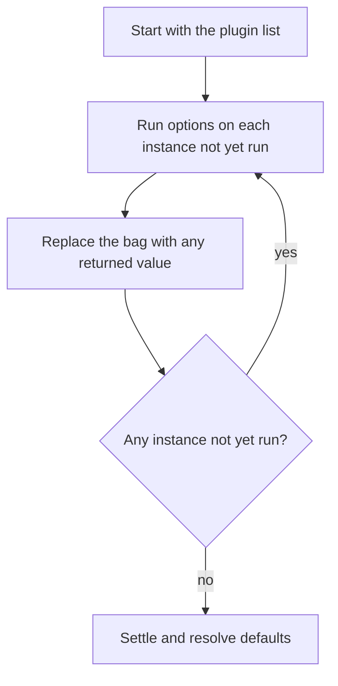

Telarel organizes the compiler around plugin hooks. A plugin is a value with a `name` and any subset of the eight hooks. The compiler skips any hook that a plugin does not implement. A plugin receives the source, the options, and the current pipeline state. It can contribute to each stage of the compiler.

The core owns all state. A hook observes its stage arguments and returns a value that the core applies. A hook that returns nothing leaves the current state unchanged. Every entry point accepts plugins alongside the options.

Rust plugins use the bundled oxc version. JavaScript plugins remain backend-independent through ESTree.

## Hooks

| Hook        | Arguments              | Return     | Semantics        |
| ----------- | ---------------------- | ---------- | ---------------- |
| `options`   | options, plugins       | options    | Fixpoint replace |
| `start`     | resolved options       | —          | Notify           |
| `parse`     | code, parser options   | ast        | First-win        |
| `prepare`   | ast                    | —          | Observer         |
| `transform` | ast                    | ast        | Carried fold     |
| `finalize`  | ast                    | —          | Observer         |
| `generate`  | ast, generator options | code, map? | First-win        |
| `end`       | error?                 | —          | Notify           |

### Hook semantics

**`options`: fixpoint replace.** The pipeline runs this hook first and then resolves options. It runs the hook as a sequential fixpoint over the plugin list. A fixpoint repeats until no instance is new work. It then settles.

- **Identity.** The instance is the identity, not the `name`. Each distinct instance runs once.
- **Replacement.** A same-name replacement counts as new work. The pipeline preserves duplicate entries of one instance.
- **Return.** A returned bag replaces the whole bag at struct level. Omitted fields take their default values. Returning nothing keeps the current bag.
- **Payload.** The payload is the resolvable options and the plugin list. It never includes the source. Unset fields stay absent until the fixpoint settles.
- **Depth.** An instance created every pass is new work every pass. It reaches `MAX_OPTIONS_DEPTH`.

**`start`: notify.** The pipeline runs `start` on every settled entry. The hook receives the fully resolved, read-only options. The pipeline ignores return values. The first error aborts.

**`parse`: first-win.** The pipeline iterates over the plugins that implement this hook. In a first-win stage, the first plugin that returns an AST wins and the pipeline skips the rest. A plugin that returns nothing defers. A deferral passes control to the next plugin.

If every hook defers, the builtin parser runs. The builtin is the compiler's own parser or generator.

After a `parse` hook wins, the pipeline attaches the requested input source map only when the returned AST has no input map. The AST's own input map wins.

**`prepare` / `finalize`: observers.** The pipeline runs each hook as a read-only observer of the AST. `prepare` observes the parsed AST. `finalize` observes the final AST. The pipeline ignores return values, and these hooks cannot change the tree. In JavaScript, these hooks and `generate` receive an `Ast` snapshot. Mutations to the snapshot stay local to the hook.

**`transform`: carried fold.** The pipeline iterates over the plugins that implement this hook. A carried fold passes one owned AST from plugin to plugin. Each hook can replace that AST. The **last** replacement AST returned wins. Returning nothing leaves the carried AST untouched.

- **Rust.** The argument is an owned cheap handle. The hook calls `Ast::with_mut` to mutate the AST.
- **JavaScript.** The argument is an `Ast` instance. The hook calls `Ast.mutate` to mutate the AST, and the returned `Ast` replaces the instance.

**`generate`: first-win.** The pipeline iterates over the plugins that implement this hook. The first plugin that returns code wins and the pipeline skips the rest. A plugin that returns nothing defers to the next plugin. If every plugin defers, the builtin generator regenerates the code.

**`end`: notify.** The pipeline runs this hook on every settled entry and on every path. It runs when the compile fails, but it does not run when the `options` stage fails. The pipeline ignores return values.

### Usage gating

| Hooks                                                   | Runs on                                  |
| ------------------------------------------------------- | ---------------------------------------- |
| `options`                                               | each distinct instance, once             |
| `start`, `end`                                          | every settled entry, duplicates included |
| `parse`, `prepare`, `transform`, `finalize`, `generate` | only plugins that declare the hook       |

Parsing and code regeneration always run. If no plugin declares a stage, the builtin parser or generator runs that stage.

### Entry points

The table below shows which hooks each entry point runs.

| Hook        | `parse` | `rewrite` | `generate` | `compileFromAst` | `compile` |
| ----------- | ------- | --------- | ---------- | ---------------- | --------- |
| `options`   | ✓       | ✓         | ✓          | ✓                | ✓         |
| `start`     | ✓       | ✓         | ✓          | ✓                | ✓         |
| `parse`     | ✓       |           |            |                  | ✓         |
| `prepare`   |         | ✓         |            | ✓                | ✓         |
| `transform` |         | ✓         |            | ✓                | ✓         |
| `finalize`  |         | ✓         |            | ✓                | ✓         |
| `generate`  |         |           | ✓          | ✓                | ✓         |
| `end`       | ✓       | ✓         | ✓          | ✓                | ✓         |

In Rust, the `compileFromAst` entry point is `compile_from_ast`.

### Ordering

Each hook has its own optional order. A single plugin can run `pre` for one hook and `post` for another.

| Order  | Runs                              |
| ------ | --------------------------------- |
| `pre`  | before every normal plugin        |
| unset  | normal bucket, registration order |
| `post` | after every normal plugin         |

## Plugin context

Every hook receives a context as its first argument.

- `options` receives the `CommonPluginContext`.
- Every later hook receives the `PluginContext`. The context holds the resolved `cwd` and the `module` info. The `module` info is `file`, `language`, and `source_type` / `sourceType`.
