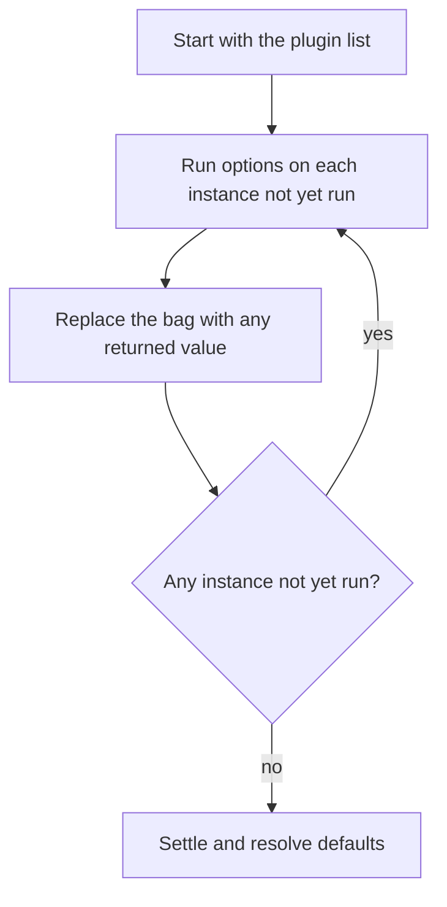

Telarel is built around plugin hooks. A plugin is a value that carries a `name` and any subset of the eight hooks; the hooks it does not implement are simply skipped. It receives the source, the options, and the current pipeline state, and can contribute to each stage of the compiler.

The core owns all state: a hook observes its stage arguments and returns a value that the core applies. A hook that returns nothing leaves the carried state unchanged. Plugins are passed to every entry point alongside the options.

Rust plugins are coupled to the bundled oxc version, while JavaScript plugins remain backend-independent through ESTree.

## Hooks

| Hook        | Arguments              | Return     | Semantics        |
| ----------- | ---------------------- | ---------- | ---------------- |
| `options`   | options, plugins       | options    | Fixpoint replace |
| `start`     | resolved options       | —          | Notify           |
| `parse`     | code, parser options   | ast        | First-win        |
| `prepare`   | ast                    | —          | Observer         |
| `transform` | ast                    | ast        | Carried fold     |
| `finalize`  | ast                    | —          | Observer         |
| `generate`  | ast, generator options | code, map? | First-win        |
| `end`       | error?                 | —          | Notify           |

### Hook semantics

**`options` — fixpoint replace.** Runs before options are resolved, as a sequential fixpoint over the plugin list. Identity is the instance, not the name: each distinct instance runs once, a same-name replacement counts as new work, and duplicates of one instance are preserved.

- **Return.** A returned bag replaces the whole bag at struct level, so omitted fields fall back to defaults. Returning nothing keeps the current bag.
- **Payload.** Resolvable options and the plugin list, never the source. Unset fields stay unset until the fixpoint settles.
- **Depth.** An instance created every pass is new work every pass and reaches `MAX_OPTIONS_DEPTH`.

**`start` — notify.** Runs on every settled plugin with the fully resolved, read-only options. Return values are ignored; the first error aborts.

**`parse` — first-win.** Runs over the plugins that implement it. The first plugin returning an AST wins and the rest are skipped; returning nothing defers to the next plugin; when every hook defers the builtin parser runs. After a `parse` hook wins, the pipeline attaches the requested input source map when the returned AST carries none; an AST's own input map wins.

**`prepare` / `finalize` — observers.** Each runs as a read-only observer of the AST — the parsed AST for `prepare`, the final AST for `finalize`. Return values are ignored; they cannot change the tree. In JavaScript these hooks, and `generate`, receive an `Ast` snapshot whose mutations stay local to the hook.

**`transform` — carried fold.** Runs over the plugins that implement it, carrying an owned AST from plugin to plugin. The **last** replacement AST returned wins; returning nothing leaves the carried AST untouched. In Rust the argument is an owned cheap handle and mutation goes through `Ast::with_mut`; in JavaScript the argument is an `Ast` instance, mutation goes through `Ast.mutate`, and the returned `Ast` replaces it.

**`generate` — first-win.** Runs over the plugins that implement it. The first plugin returning code wins and the rest are skipped; returning nothing defers to the next plugin, and ultimately to the builtin generator.

**`end` — notify.** Runs on every settled plugin on every path, including when the compile failed — but not when the `options` stage itself fails. Return values are ignored.

### Usage gating

| Hooks                                                   | Runs on                                  |
| ------------------------------------------------------- | ---------------------------------------- |
| `options`                                               | each distinct instance, once             |
| `start`, `end`                                          | every settled entry, duplicates included |
| `parse`, `prepare`, `transform`, `finalize`, `generate` | only plugins that declare the hook       |

Parsing and code generation always run: a stage that no plugin declares falls back to the builtin parser or generator.

### Entry points

Which hooks each entry point runs:

| Hook        | `parse` | `rewrite` | `generate` | `compileFromAst` | `compile` |
| ----------- | ------- | --------- | ---------- | ---------------- | --------- |
| `options`   | ✓       | ✓         | ✓          | ✓                | ✓         |
| `start`     | ✓       | ✓         | ✓          | ✓                | ✓         |
| `parse`     | ✓       |           |            |                  | ✓         |
| `prepare`   |         | ✓         |            | ✓                | ✓         |
| `transform` |         | ✓         |            | ✓                | ✓         |
| `finalize`  |         | ✓         |            | ✓                | ✓         |
| `generate`  |         |           | ✓          | ✓                | ✓         |
| `end`       | ✓       | ✓         | ✓          | ✓                | ✓         |

In Rust, `compileFromAst` is spelled `compile_from_ast`.

### Ordering

Every hook carries its own optional order, so a single plugin can run `pre` for one hook and `post` for another.

| Order  | Runs                              |
| ------ | --------------------------------- |
| `pre`  | before every normal plugin        |
| unset  | normal bucket, registration order |
| `post` | after every normal plugin         |

## Plugin context

Every hook receives a context as its first argument.

- `options` receives the `CommonPluginContext`.
- Every later hook receives the `PluginContext`, carrying the resolved `cwd` and `module` info (`file`, `language`, and `source_type` / `sourceType`).
